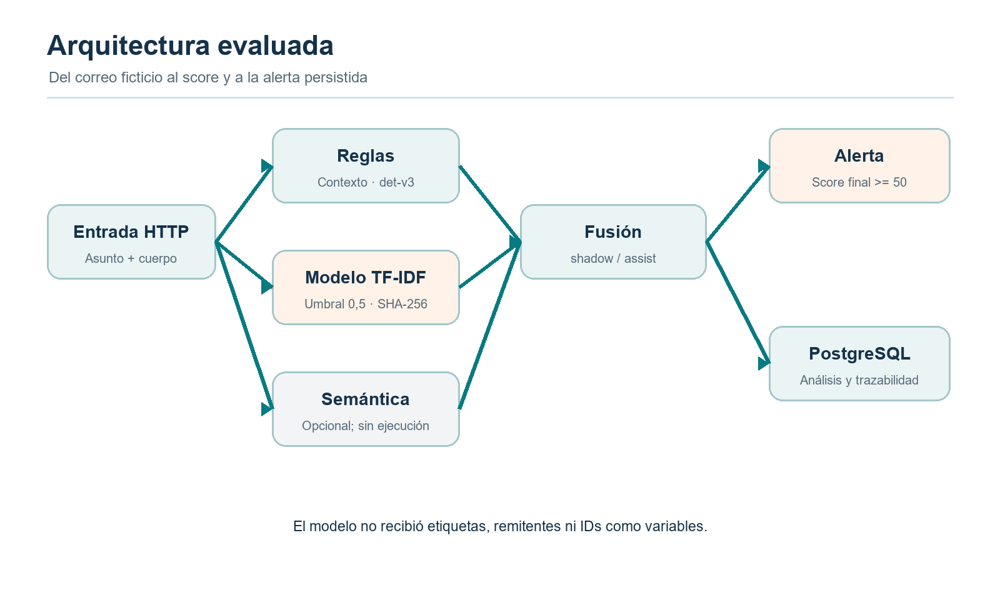
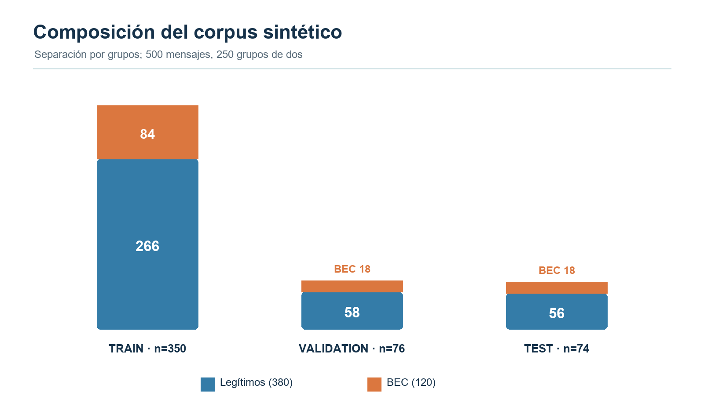
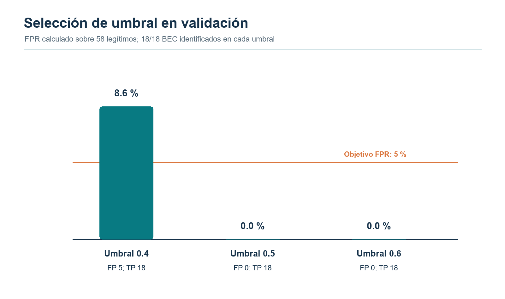
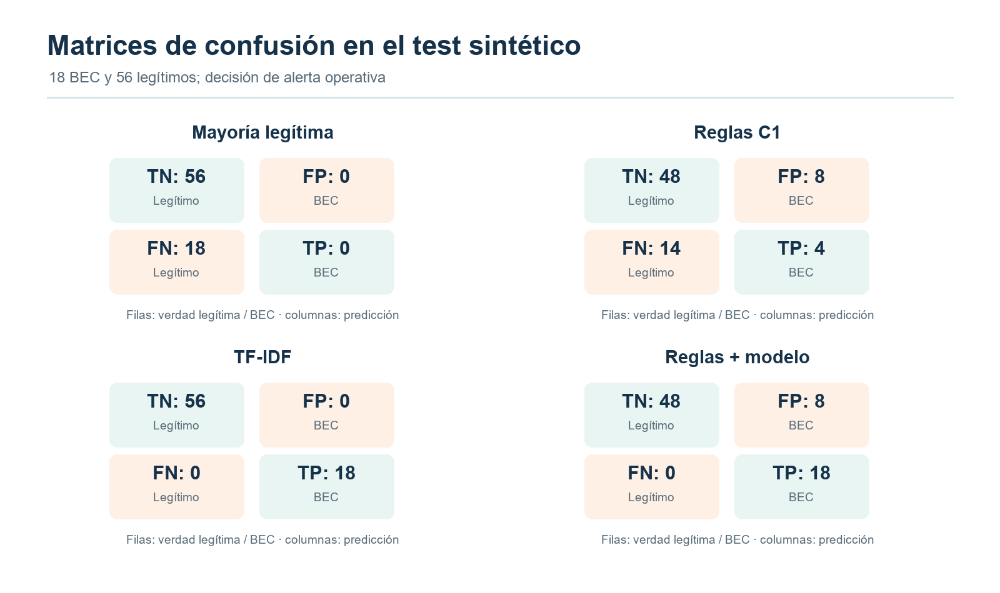
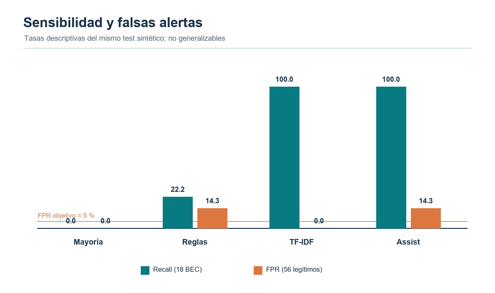

# Del laboratorio a la alerta: integración auditable de un clasificador supervisado en un detector híbrido de fraude ejecutivo por correo electrónico

**Tipo de contribución:** artículo de implementación y evaluación controlada con datos sintéticos.

## Resumen

**Contexto.** El compromiso de correo empresarial (BEC) combina ingeniería social y contexto organizacional; los corpus públicos rara vez reúnen ataques y correos legítimos comparables. **Objetivo.** Se articuló un programa de entrenamiento con un programa funcional y se comprobó su integración auditable y la transferencia del clasificador a fuentes externas. **Método.** Se generaron 500 correos sintéticos agrupados en 250 pares (120 BEC y 380 legítimos), particionados en entrenamiento (350), validación (76) y prueba (74). Se entrenó TF-IDF con regresión logística y umbral congelado en 0,5. El programa funcional fijó por hash pesos e informe y ejecutó el artefacto en `shadow` sobre FastAPI y PostgreSQL; la lógica `assist` se ensayó mediante inyección controlada en una base aislada. Se puntuaron BEC-2 y correos `ham` de Enron y CEAS 2008 sin reentrenar el primer modelo. **Resultados.** En el test propio, el clasificador obtuvo 18 verdaderos positivos y 0 falsos positivos; las reglas obtuvieron 4 y 8, respectivamente, y su combinación conservó los 8 falsos positivos (14,3 %). En la prueba externa, el modelo detectó 276/276 BEC sintéticos, pero marcó 31.396/32.763 legítimos históricos como BEC (95,8 % de falsos positivos). Un reentrenamiento público exploratorio invirtió el fallo: 0/276 BEC-2 detectados y 0/17.289 falsos positivos CEAS. El recorrido HTTP verificó persistencia e idempotencia. **Conclusión.** La integración se verificó, pero ninguno de los dos modelos sostuvo simultáneamente detección y control de falsos positivos entre fuentes. La puerta del programa funcional mantuvo `assist` bloqueado para ambos; no se estableció eficacia sobre BEC real.

**Palabras clave:** compromiso de correo empresarial; detección híbrida; clasificación supervisada; evaluación reproducible; datos sintéticos; integración de sistemas.

## 1. Introducción

El fraude por compromiso de correo empresarial consiste en suplantar a un directivo, proveedor o colaborador para inducir transferencias de fondos o la entrega de información sensible, y su eficacia depende menos de un artefacto técnico que de la confianza que el mensaje logra movilizar. Las autoridades estadounidenses documentaron que el BEC y el fraude por correo electrónico concentraron pérdidas muy superiores a las de otras categorías de delito cibernético reportadas, lo que situó el problema entre las prioridades operativas de las organizaciones (Federal Bureau of Investigation, 2024). La investigación criminológica mostró que el ataque explotaba la confianza en relaciones de autoridad y proveeduría más que una vulnerabilidad técnica (Cross & Gillett, 2020), que su ejecución requería escasa pericia informática (Mansfield-Devine, 2016) y que el factor humano concentraba buena parte del riesgo residual (Verizon, 2025); las revisiones del fenómeno describieron, además, un repertorio estable de modalidades que iba desde el cambio de datos bancarios hasta la suplantación de directivos (Al-Musib et al., 2023). Esa magnitud explica por qué la detección se abordó con combinaciones de señales de contenido, de identidad y de contexto, en lugar de depender de un único indicador.

La literatura técnica mostró que la detección de alta precisión era alcanzable cuando el análisis incorporaba relaciones organizacionales y no solo el texto del mensaje. Cidon et al. (2019) demostraron que un sistema que modelaba la estructura de la organización y el comportamiento de comunicación podía detectar BEC con muy baja tasa de falsos positivos, y su aporte desplazó el foco desde las listas de palabras hacia la verificación de identidad y contexto. Ho et al. (2019) caracterizaron el phishing lateral sobre 113 millones de correos de 92 organizaciones y mostraron que una cuenta comprometida podía reutilizar la confianza interna para propagar el ataque, mientras que Gascon et al. (2018) aprovecharon rasgos ajenos al contenido para construir perfiles de remitente y detectar suplantaciones con menos de un falso positivo cada diez mil mensajes. Brabec et al. (2023) llevaron esa lógica a un sistema modular de producción que combinó modelos independientes sobre texto, metadatos y contexto de comunicación, y argumentaron que la descomposición en detectores explicables era una condición para operar a escala. En paralelo, la comunidad enfrentó la escasez de datos: los correos reales de ataques son sensibles y rara vez se comparten con etiquetas verificadas, de modo que los corpus públicos se construyeron con generación automática o con datos anonimizados. Dube (2025) documentó la creación de un conjunto de investigación de BEC mediante modelos de lenguaje, con 279 mensajes distribuidos en familias de plantilla y etiquetas humanas mayoritariamente positivas, y advirtió sobre los límites de ese material para estimar desempeño. Las revisiones sistemáticas de la década coincidieron en que los detectores supervisados dependían de características textuales y de contexto cuyo costo de extracción condicionaba su adopción (Atlam & Oluwatimilehin, 2023; Almutairi et al., 2025), y los estudios sobre estilo de escritura y sobre correos generados con modelos de lenguaje mostraron que las señales lingüísticas podían aprenderse con eficacia y también imitarse con facilidad creciente (Vorobeva et al., 2022; Hazell, 2023). La revisión de Jáñez-Martino et al. (2023) añadió una advertencia metodológica: los filtros entrenados sobre una distribución de correo perdían desempeño cuando la distribución operativa cambiaba, de modo que la procedencia y la fecha del material de entrenamiento debían declararse junto con las métricas. La consecuencia fue una brecha doble: por un lado, muchos detectores se evaluaron sobre datos cuya procedencia y separación entre entrenamiento y prueba no se describía con suficiente detalle; por otro, salvo las excepciones que describieron sistemas completos en producción (Brabec et al., 2023), las arquitecturas híbridas que combinaban reglas, contexto y modelos aprendidos rara vez documentaron cómo se integraba el clasificador en el flujo de decisión y cómo se evitaba que una probabilidad del modelo se confundiera con una alerta.

Este trabajo abordó esa brecha desde la ingeniería de sistemas y no desde la demostración de superioridad empírica. El propósito fue describir una implementación reproducible en la que un clasificador supervisado local se incorporara a un detector híbrido existente sin alterar sus garantías de reversibilidad, y contrastar su comportamiento frente a fuentes externas sin cambiar el artefacto. La pregunta que guió el estudio fue si era posible conectar el modelo al análisis principal, registrar su contribución de manera auditable y observar qué ocurría cuando salía del corpus sintético que lo había originado. La respuesta se organizó en cuatro contribuciones: una arquitectura de dos programas —entrenamiento y operación— unidos por un contrato de artefactos, con tres modos de ejecución y trazabilidad criptográfica; una partición por grupos y selección de umbral congelada antes del test; un recorrido funcional verificado de extremo a extremo que documentó el efecto del modelo sobre el score y las alertas; y un diagnóstico externo por fuente que cuantificó el fallo de transferencia a correos legítimos históricos. El artículo presentó primero la arquitectura, luego los materiales y métodos, después los resultados sintéticos, externos y del recorrido HTTP, y finalmente la discusión y las conclusiones.

## 2. Arquitectura: programa principal y programa de entrenamiento

El trabajo se organizó en dos programas con responsabilidades separadas. El programa de entrenamiento fue un laboratorio local que ingirió y validó el corpus, lo exploró, ajustó el clasificador bajo un presupuesto declarado y comparó condiciones sobre las particiones congeladas; su salida fue un paquete de artefactos compuesto por el modelo serializado, el informe de entrenamiento y los hashes del corpus, del contexto y del propio informe. El programa principal fue el detector operativo: una interfaz web para la gestión de correos, alertas, contexto organizacional, auditoría y usuarios, apoyada en un servicio FastAPI y una base PostgreSQL. Ambos se conectaron mediante un contrato de artefactos y no mediante código compartido: el programa principal solo cargó un modelo cuya ruta y SHA-256 coincidieron con los declarados, de modo que un cambio en el laboratorio no pudo alterar el detector sin una actualización explícita de la configuración.

El programa principal recibió cada correo mediante un contrato de ingesta y lo procesó en un servicio de análisis que combinó tres fuentes de señal: reglas deterministas sobre contenido y remitente, contexto organizacional del dominio ficticio y, cuando estuvo configurado, un analizador semántico externo. Sobre esa base se añadió un clasificador supervisado local que leyó asunto y cuerpo, devolvió una probabilidad de la clase BEC y se ejecutó bajo un contrato explícito de carga: ruta del artefacto y hash SHA-256 declarados en la configuración, verificación del hash antes de deserializar y rechazo del modelo si la verificación fallaba. La Figura 1 resumió el recorrido, desde la entrada hasta la alerta persistida.

**Figura 1.** Arquitectura del flujo de análisis: entrada, señales deterministas, clasificador local opcional, fusión de score y persistencia de alertas.

La decisión de diseño central fue no tratar la probabilidad del modelo como un riesgo calibrado. Una predicción positiva se tradujo en un piso ordinal de alerta de 50, equivalente al umbral de alerta del producto, mientras que una predicción negativa no modificó el score. Esa conversión preservó la semántica del sistema existente, en el que el score era una escala de priorización y no una probabilidad, y evitó que un modelo con calibración desconocida redefiniera el significado de las alertas. El desglose persistido registró el modo activo, la probabilidad del modelo, el score aportado y el hash del artefacto, de modo que cada análisis pudo auditarse después.

Los modos de operación hicieron explícita la relación entre el modelo y la decisión. En `disabled`, el clasificador no se cargó ni se consultó. En `shadow`, el modelo se ejecutó y su resultado se registró, pero el score final y las alertas permanecieron determinados por las reglas y el contexto. En `assist`, el score final fue el máximo entre el score previo y el piso del modelo, tanto en el camino de análisis semántico completo como en el camino de respaldo cuando el proveedor externo no estaba disponible. Esta última distinción fue relevante porque el sistema ya contemplaba un estado de `FALLBACK`, y la integración debía comportarse igual en ambos caminos para no crear una vía de decisión inconsistente.

La Figura 6 mostró el programa de entrenamiento en funcionamiento. Su interfaz reunió la carga y validación del corpus, la exploración de casos, el entrenamiento con presupuesto controlado y la comparación entre condiciones, y desde ella se descargaron el modelo y el informe que el programa principal consumió. Con eso, la preparación de datos y la reproducción del experimento dejaron de depender de scripts aislados y pasaron a formar parte de un flujo verificable.

**Figura 6.** Captura del programa de entrenamiento, con el centro de investigación y el estado de carga de casos.

## 3. Materiales y métodos

### 3.1. Corpus sintético y partición

El programa de entrenamiento generó el corpus con un script que produjo mensajes ficticios en dominios reservados y cuatro familias de plantilla, cada una con variaciones de asunto, cuerpo y remitente. El material no provino de correos capturados ni de ataques reales: cada caso se marcó con el estado `SYNTHETIC_GENERATED`, que lo distinguió de un corpus adjudicado. La generación se orientó a cubrir solicitudes de pago, cambios de datos bancarios, pedidos de información y suplantación de autoridad, junto con mensajes legítimos que compartían vocabulario con los fraudulentos para que la tarea no se resolviera por palabras aisladas.

El conjunto final contuvo 500 mensajes organizados en 250 grupos de dos mensajes relacionados, con 120 etiquetas BEC y 380 legítimas, e incluyó 100 negativos difíciles, es decir, mensajes legítimos construidos para parecerse a una solicitud sensible. La Tabla 1 detalló la composición y el resultado de la partición. El particionador separó por grupo, de modo que los dos mensajes de un mismo grupo cayeron siempre en la misma partición, y reservó 350 mensajes para entrenamiento, 76 para validación y 74 para prueba, con 18 casos BEC y 56 legítimos en prueba. La Figura 2 representó la distribución por etiqueta y partición.

**Tabla 1.** Composición del corpus sintético y particiones por grupo.

| Elemento | Valor |
| --- | ---: |
| Mensajes totales | 500 |
| Etiquetas BEC / legítimas | 120 / 380 |
| Grupos de dos mensajes | 250 |
| Negativos difíciles | 100 |
| Entrenamiento (BEC / legítimos) | 350 (84 / 266) |
| Validación (BEC / legítimos) | 76 (18 / 58) |
| Prueba (BEC / legítimos) | 74 (18 / 56) |
| Negativos difíciles en prueba | 8 |
| Estado de etiqueta | `SYNTHETIC_GENERATED` |
| Semilla de partición | 20261118 |

**Figura 2.** Composición del corpus sintético por etiqueta y partición.

La partición por grupo evitó la fuga directa de mensajes emparejados, pero no eliminó la similitud entre familias de plantilla: los grupos separados compartieron estructuras, vocabulario y estilos de redacción porque provinieron del mismo generador. Esa regularidad se declaró como límite estructural del experimento y condicionó la interpretación de los resultados, porque un clasificador podía aprovechar señales de familia que no estarían disponibles en correo real.

### 3.2. Entrenamiento y configuración congelada

En el programa de entrenamiento, el clasificador se construyó como una canalización de vectorización TF-IDF de palabras seguida de una regresión logística con penalización L2. La búsqueda evaluó 12 combinaciones predefinidas de rango de n-gramas, inverso de la regularización y balanceo de clases, y usó validación cruzada agrupada de tres pliegues sobre la partición de entrenamiento. La Tabla 2 resumió la rejilla y la configuración finalmente congelada.

**Tabla 2.** Rejilla de entrenamiento y configuración congelada del clasificador.

| Parámetro | Valores explorados | Seleccionado |
| --- | --- | --- |
| Rango de n-gramas | (1,1), (1,2) | (1,1) |
| Inverso de regularización (`C`) | 0,1 / 1,0 / 10,0 | 0,1 |
| Balanceo de clases | ninguno / `balanced` | `balanced` |
| Pliegues de validación cruzada | 3, agrupados | 3 |
| Solver / tolerancia / iteraciones | `liblinear` / 1e-4 / 1000 | igual |
| Umbral de decisión | 0,4 / 0,5 / 0,6 | 0,5 |
| Configuraciones evaluadas | 12 | 1 |
| Semilla de entrenamiento | 20261118 | 20261118 |
| Versión de scikit-learn | — | 1,9,1 |

La selección no usó el conjunto de prueba. El umbral se eligió sobre validación y se guardó junto con el modelo, de modo que el artefacto desplegado llevara su propia regla de decisión y el servicio no tuviera que reconstruirla. El modelo se serializó con `joblib` y su hash se fijó en la configuración de la aplicación, junto con el hash del informe de entrenamiento y del corpus, para que cualquier cambio de artefacto fuera detectable antes de ejecutar una predicción. La implementación se apoyó en scikit-learn (Pedregosa et al., 2011) y la validación cruzada agrupada siguió el esquema de estimación de error descrito por Kohavi (1995).

### 3.3. Selección de umbral

La validación comparó tres umbrales sobre 18 casos BEC y 58 legítimos. El umbral 0,4 produjo cinco falsos positivos y una tasa de falsos positivos de 8,6 %, mientras que 0,5 y 0,6 no produjeron falsos positivos y mantuvieron los 18 verdaderos positivos. La Tabla 3 presentó esas cifras y la Figura 3 las contrastó con el objetivo predeclarado de 5 %.

**Tabla 3.** Desempeño en validación según umbral de decisión.

| Umbral | TP | FP | TN | FN | Recall | FPR | Precision |
| ---: | ---: | ---: | ---: | ---: | ---: | ---: | ---: |
| 0,4 | 18 | 5 | 53 | 0 | 100,0 % | 8,6 % | 78,3 % |
| 0,5 | 18 | 0 | 58 | 0 | 100,0 % | 0,0 % | 100,0 % |
| 0,6 | 18 | 0 | 58 | 0 | 100,0 % | 0,0 % | 100,0 % |

**Figura 3.** Tasa de falsos positivos en validación para los umbrales evaluados y objetivo del 5 %.

La elección de 0,5 siguió el criterio predeclarado de menor umbral que cumpliera el objetivo de falsos positivos, con lo que se preservó margen para detectar casos límite sin sacrificar la meta de precisión. La calibración se verificó además con el índice de Brier sobre validación, que arrojó 0,1115 frente a una referencia de 0,1807 (Brier, 1950), y esa comprobación se registró como aprobada en el informe de entrenamiento.

### 3.4. Condiciones de comparación y métricas

La comparación descriptiva volvió a puntuar el mismo conjunto de prueba que ya había evaluado el informe de entrenamiento, por lo que no constituyó una segunda prueba independiente. Se compararon cuatro condiciones: un baseline mayoritario que siempre predijo la clase legítima, las reglas del producto con umbral de alerta 50, el clasificador solo con su umbral congelado y la combinación de reglas y clasificador en modo `assist`. Se reportaron verdaderos positivos, falsos positivos, verdaderos negativos, falsos negativos, exhaustividad, tasa de falsos positivos y precisión, con BEC como clase positiva, y se contaron por separado las alertas falsas sobre los ocho negativos difíciles de prueba. Esa selección de métricas respondió al desbalance entre clases, en el que la exactitud global habría ocultado el costo de los falsos negativos y en el que la curva de precisión y exhaustividad resultaba más informativa que la curva ROC (Saito & Rehmsmeier, 2015).

No se ejecutó un proveedor de lenguaje real ni se calcularon costos de inferencia semántica; esas condiciones quedaron registradas como no ejecutadas. Tampoco se calcularon intervalos de confianza ni pruebas de significación, porque el escenario no medía generalización y presentar esos cálculos habría sugerido una precisión estadística que el diseño no podía sostener.

### 3.5. Ensayo externo de transferencia del modelo congelado

Para contrastar la sensibilidad del resultado a un cambio de fuente, se puntuó el mismo artefacto, sin reentrenar ni ajustar el umbral de 0,5, sobre 276 mensajes `positive` según la etiqueta humana de BEC-2 (Dube, 2025) y sobre correos con `label=0` —legítimos según la etiqueta de origen— de `Enron.csv` y `CEAS_08.csv`, publicados en la colección curada por Champa (2023). Se usaron asunto y cuerpo con la misma concatenación del programa principal; se excluyeron los casos neutrales, spam/phishing y duplicados exactos normalizados dentro de cada fuente. El programa de entrenamiento exportó el modelo, el programa principal definió el contrato de inferencia y un script offline verificó los hashes antes de puntuar los CSV públicos. Las etiquetas de los autores de los datasets se tomaron tal como fueron publicadas, sin atribuirles adjudicación BEC por este estudio. Se reportaron exhaustividad sobre BEC-2 y tasas de falsos positivos sobre cada fuente de correo legítimo por separado; la precisión de una mezcla de esas fuentes se consideró exclusivamente descriptiva. No se puntuaron reglas ni `assist` porque los CSV externos no contenían el contexto organizacional requerido por el programa principal.

Tras observar el fallo del primer modelo, se realizó un segundo entrenamiento **exploratorio**, separado del protocolo principal: se conservaron los 84 BEC y 266 legítimos del split sintético de entrenamiento y se añadieron hasta 12.000 `ham` Enron deduplicados. Un reparto determinista por hash reservó otros 3.118 `ham` Enron para validación junto con los 76 casos sintéticos; la configuración TF-IDF y regresión logística permaneció fija y el umbral se eligió solo con esa validación bajo FPR <= 5 %. Después se puntuaron BEC-2 y CEAS. Como esas fuentes ya se habían observado en el diagnóstico anterior, este segundo contraste **no constituyó un test final independiente** ni se utilizó para afirmar una mejora. El reporte de ambos ensayos guardó únicamente conteos y hashes, sin cuerpos de correo.

### 3.6. Recorrido funcional sobre HTTP y base de datos

La integración entre ambos programas se verificó con un recorrido de extremo a extremo mediante `TestClient` y una instancia local y aislada de PostgreSQL 18. Se aplicaron las migraciones 0001 a 0019 y se recorrieron los endpoints de autenticación, ingesta, análisis, consulta y alertas con el proveedor semántico desactivado. `shadow` cargó el modelo fixture con hashes de pesos e informe; para observar el efecto de `assist` con ese mismo fixture, el arnés de prueba inyectó explícitamente una predicción asistida solo en el proceso de prueba. El servicio configurado normalmente **rechazó** `assist` con informes de fixture o de diagnóstico público. Para ambos caminos de la prueba se registraron códigos HTTP, score, alertas, persistencia, idempotencia y vínculo entre alerta y análisis.

### 3.7. Reproducibilidad y presupuesto

Todos los artefactos se versionaron con hash y el experimento se ejecutó dentro de un presupuesto declarado de 7200 segundos, 5000 casos y 12 configuraciones. Los cálculos numéricos se apoyaron en NumPy (Harris et al., 2020) y las figuras se generaron con Matplotlib (Hunter, 2007) a partir de los archivos de evidencia, sin edición manual de los valores representados. La Tabla 6 reunió los identificadores que permitieron reconstruir el escenario y comprobar que los resultados correspondían a los artefactos citados.

## 4. Resultados

### 4.1. Comparación en el conjunto de prueba sintético

La Tabla 4 presentó el resultado de las cuatro condiciones sobre los 74 casos de prueba. El baseline mayoritario no detectó ningún caso BEC. Las reglas del producto detectaron 4 de 18 casos y generaron 8 falsos positivos, con una tasa de falsos positivos de 14,3 %. El clasificador solo detectó los 18 casos BEC sin falsos positivos. La combinación en modo `assist` detectó los 18 casos BEC pero conservó los 8 falsos positivos de las reglas, con lo que su tasa de falsos positivos igualó la de las reglas y su precisión quedó en 69,2 %.

**Tabla 4.** Comparación descriptiva de condiciones en el conjunto de prueba sintético.

| Condición | TP | FP | TN | FN | Recall | FPR | Precision |
| --- | ---: | ---: | ---: | ---: | ---: | ---: | ---: |
| Mayoría legítima | 0 | 0 | 56 | 18 | 0,0 % | 0,0 % | Indefinida |
| Reglas C1 | 4 | 8 | 48 | 14 | 22,2 % | 14,3 % | 33,3 % |
| Clasificador TF-IDF | 18 | 0 | 56 | 0 | 100,0 % | 0,0 % | 100,0 % |
| Reglas + clasificador (`assist`) | 18 | 8 | 48 | 0 | 100,0 % | 14,3 % | 69,2 % |

Los ocho negativos difíciles de prueba recibieron alerta falsa tanto de las reglas como de la combinación, y el clasificador solo no los marcó. La Figura 4 mostró las matrices de confusión y la Figura 5 contrastó exhaustividad y tasa de falsos positivos entre condiciones.

**Figura 4.** Matrices de confusión de las cuatro condiciones evaluadas sobre el conjunto de prueba sintético.

**Figura 5.** Exhaustividad y tasa de falsos positivos por condición en el conjunto de prueba sintético.

El patrón fue consistente con la lógica de fusión: como `assist` tomó el máximo entre el score previo y el piso del modelo, cualquier alerta generada por las reglas se mantuvo aunque el modelo no la respaldara. La combinación elevó la exhaustividad porque el modelo cubrió los casos que las reglas no detectaron, pero no pudo retirar los falsos positivos que ya existían, y por eso no cumplió el objetivo de 5 % de falsos positivos en este escenario.

### 4.2. Transferencia a fuentes públicas externas

El contraste externo mostró una diferencia sustancial respecto del test producido por el mismo generador que los datos de entrenamiento. El modelo clasificó como BEC los 276 mensajes positivos de BEC-2 (276 TP y 0 FN), pero también marcó 14.976 de 15.474 correos legítimos únicos de Enron (498 TN; FPR 96,8 %) y 16.420 de 17.289 correos legítimos únicos de CEAS 2008 (869 TN; FPR 95,0 %). En total, 31.396 de 32.763 negativos externos fueron falsos positivos (FPR 95,8 %); se excluyeron 317 duplicados exactos de Enron y 23 de CEAS antes del cómputo. La composición artificial BEC-2 + negativos de ambas fuentes dio TP 276, FN 0, FP 31.396 y TN 1.367, con precisión de 0,87 % para una prevalencia construida de 0,84 %. Ni esa precisión ni dicha prevalencia describieron tráfico empresarial en producción. Las cuatro familias BEC-2 y la separación por fuente impidieron interpretar estas cifras como tasas de generalización a BEC real, pero sí refutaron la aparente ausencia de falsos positivos del test interno frente a estos correos legítimos externos.

El reentrenamiento exploratorio v2 seleccionó 0,5 con 18/18 BEC sintéticos y 31 falsos positivos entre 3.176 negativos de validación mezclados; al puntuar las otras fuentes produjo **0/276** verdaderos positivos en BEC-2 y **0/17.289** falsos positivos en CEAS `ham`. Añadir `ham` externo redujo los avisos erróneos en esa fuente, pero eliminó toda detección del conjunto positivo externo. El informe marcó `FAILS_PROXY_TARGETS`, y el producto mantuvo el artefacto limitado a observación. Ese contraste posterior se comunicó como exploración, no como segunda evaluación confirmatoria.

### 4.3. Recorrido funcional de la integración

La Tabla 5 resumió el recorrido HTTP. En modo `shadow`, la ingesta respondió 201 y el análisis 200; el estado del análisis fue `FALLBACK` por ausencia de proveedor semántico, el score determinista fue 16, el modelo aportó un score de 50 y el score final permaneció en 16, sin alertas. En modo `assist`, la ingesta y el análisis respondieron con los mismos códigos y el mismo estado, pero el score final pasó a 50 y se creó una alerta. En ambos modos el análisis se persistió y una segunda solicitud con los mismos datos devolvió el mismo resultado, y en `assist` el detalle de la alerta quedó vinculado al análisis.

**Tabla 5.** Recorrido funcional en TestClient: observación real del fixture y contrafactual asistido sobre PostgreSQL aislado.

| Registro | `shadow` | `assist` |
| --- | ---: | ---: |
| Código de ingesta | 201 | 201 |
| Código de análisis | 200 | 200 |
| Estado del análisis | `FALLBACK` | `FALLBACK` |
| Score determinista | 16 | 16 |
| Score del modelo | 50 | 50 |
| Score final | 16 | 50 |
| Alertas creadas | 0 | 1 |
| Persistido | Sí | Sí |
| Idempotente | Sí | Sí |
| Alerta vinculada al análisis | No aplica | Sí |
| Llamadas al proveedor semántico | 0 | 0 |

El recorrido confirmó que el modo de observación no alteró la decisión operativa y que la lógica asistida inyectada en el arnés aplicó el piso del modelo sin romper la persistencia ni la idempotencia. Fue una prueba de integración del camino de respaldo, no una habilitación de `assist` con pesos no validados.

### 4.4. Verificación del software

La suite automatizada se ejecutó contra PostgreSQL aislado y finalizó con **666 pruebas aprobadas y 4 omitidas**; las omisiones correspondieron a generación PDF con dependencia nativa no disponible. Estilo, formato, tipado estático y bloqueo de dependencias finalizaron sin errores, y la migración 0019 se aplicó y revirtió. Se verificó que el programa funcional rechazara `assist` con informes de fixture o públicos, y que un hash alterado del informe detuviera la inferencia. El modelo v2 sí se cargó en `shadow`. La Tabla 6 reunió los hashes y el presupuesto del ensayo.

**Tabla 6.** Artefactos de reproducibilidad, hashes y presupuesto de ejecución.

| Artefacto | Identificador |
| --- | --- |
| Corpus (`dataset.jsonl`) | `0b51b2032004c2277bdff2a7f63c533512e0a5da2fd04307c705f3ba23cfc292` |
| Modelo (`joblib`) | `7a163d9141c3404ff28d428e2a7f4b14be4010c26811899c36a5840c0cdd0a06` |
| Contexto organizacional | `d380cefda6352bd254f64979dc55e61e6f07afb3112496f0f11b25ad7edc1d0e` |
| Manifiesto de partición | `c3627ebda6f1b8c7d01b2f499603111c9d19b2e41d109120f9dac5e43d9418ad` |
| Informe de entrenamiento | `53842f6734ec11c03a8c505af5a38d0593d5b651d5cb7f8bbabcee33c865b761` |
| Modelo v2 exploratorio | `0061b7e730c9164994eb19e580879e814818558e542181f7478cc2ef6cbcc772` |
| Informe v2 exploratorio | `10e4b65796b222200f043603274aaa1044e986b79c1a5a76470f6ba3eeeaaf20` |
| Evidencia agregada | `SYNTHETIC_FIXTURE_REUSE_DESCRIPTIVE_ONLY` |
| Contraste externo | `CROSS_SOURCE_SYNTHETIC_BEC_AND_PUBLIC_HAM_DIAGNOSTIC_ONLY` |
| Recorrido HTTP | `ISOLATED_SYNTHETIC_HTTP_DB_WALKTHROUGH` |
| Commit del entrenamiento v1 | `51cdebf87939a7877c3a44b2a4b8cd1d6c09d648` |
| Presupuesto | 7200 s, 5000 casos, 12 configuraciones |
| Proveedor semántico | No ejecutado (`NOT_RUN`) |

## 5. Discusión

El resultado más relevante no fue la diferencia entre el clasificador y las reglas, sino la forma en que la arquitectura impidió que esa diferencia se tradujera automáticamente en una mejora operativa. El clasificador detectó los 18 casos BEC sin falsos positivos en el escenario sintético, pero la combinación con las reglas conservó los 8 falsos positivos preexistentes porque la fusión tomó el máximo de los scores. La prueba externa evidenció una restricción todavía mayor: el modelo señaló casi todos los correos legítimos de dos fuentes ajenas al entrenamiento. En `assist`, una predicción positiva solo podía elevar el score, nunca retirar una alerta; por ello ni la FPR interna de 14,3 % ni el diagnóstico de transferencia respaldaron promover ese modo. `shadow` permitió observar la contribución del modelo sin modificar las alertas. Esa separación entre detección y decisión coincidió con el argumento de Brabec et al. (2023) sobre la necesidad de veredictos explicables y de capas de fusión auditables en sistemas modulares de producción.

La comparación también mostró el valor de separar la probabilidad del modelo de la escala del producto. Si la probabilidad se hubiera interpretado como riesgo calibrado, cualquier umbral habría tenido un significado distinto del que las alertas ya tenían, y la revisión humana habría recibido una prioridad difícil de comparar con la de las reglas. Al convertir una predicción positiva en un piso de 50, el sistema mantuvo una semántica estable y dejó el ajuste fino para una fase posterior con datos independientes. Esa decisión fue conservadora y, en este escenario, limitó el beneficio aparente del modelo, pero preservó la coherencia del sistema. Las revisiones del área coincidieron en que la explicabilidad y la integración con el flujo operativo eran condiciones de adopción tan relevantes como la métrica aislada del clasificador (Almutairi et al., 2025).

Los resultados del escenario sintético no debían leerse como estimaciones de desempeño. Las familias de plantilla se repitieron entre particiones, de modo que el clasificador pudo aprender regularidades de generación que no sobrevivirían en correo real. La exhaustividad perfecta y la ausencia de falsos positivos del modelo fueron, en ese sentido, una señal de que la tarea era demasiado fácil para el material disponible y no una prueba de capacidad de detección. La literatura sobre BEC ya había advertido que la escasez de datos etiquetados empuja a los investigadores hacia corpus generados, y que esos corpus sirven para verificar canalizaciones pero no para estimar precisión operativa (Cidon et al., 2019; Dube, 2025). Los estudios sobre cambio de distribución explicaron ese mismo fenómeno desde la evaluación de filtros de correo: cuando el material de prueba comparte el proceso generativo del entrenamiento, las métricas observadas sobreestiman el desempeño que se obtendría en una distribución operativa distinta (Jáñez-Martino et al., 2023).

El resultado v2 reforzó esa interpretación sin resolverla: incorporar un gran número de legítimos de Enron desplazó la decisión hacia la clase benigna incluso para los ataques sintéticos externos. El nuevo 0 % de falsos positivos en CEAS no constituyó una mejora si el recall en BEC-2 cayó también a 0 %. El contraste mostró que optimizar una métrica aislada o aceptar como negativo de BEC cualquier correo `ham` histórico podía esconder un fallo simétrico; por ello se conservó la selección de umbral registrada y no se eligió retrospectivamente otra política con los casos externos.

El recorrido HTTP aportó evidencia sobre un aspecto que suele quedar fuera de los artículos de detección: la integración. La verificación de hash de pesos **e informe** antes de cargar el modelo, el registro del modo y de la probabilidad en el desglose persistido, la persistencia y la idempotencia fueron propiedades del sistema, no del clasificador. La puerta de promoción rechazó los dos informes exploratorios en `assist` sin impedir que el arnés verificara esa rama contrafactualmente sobre una base aislada. Esa separación permitió sostener afirmaciones distintas con evidencia distinta, sin atribuir a la detección un resultado que solo demostró correctitud de ingeniería.

## 6. Validez y limitaciones

La limitación principal fue la procedencia del material. Los 500 mensajes fueron artificiales, provinieron de cuatro familias de plantilla y compartieron vocabulario y estructura entre particiones pese a la separación por grupo, por lo que la evaluación interna midió principalmente la capacidad para reconocer el generador. El contraste externo confirmó la fragilidad frente a mensajes legítimos de otras fuentes, pero tampoco constituyó una validación BEC real: BEC-2 fue sintético, los negativos fueron corpus históricos de spam/*ham*, las etiquetas provinieron de sus publicadores y no se contó con campañas comunes ni con contexto de la organización. La precisión de la mezcla dependió de su prevalencia elegida artificialmente; las observaciones dentro de una misma fuente tampoco fueron independientes. Por ello no se estimaron intervalos ni se infirió eficacia sobre correo empresarial contemporáneo (Dube, 2025; Champa, 2023; Jáñez-Martino et al., 2023).

La segunda limitación fue el tamaño y la reutilización del conjunto de prueba. Los 74 casos, con 18 positivos y 56 negativos, fueron insuficientes para estimar tasas con precisión, y la comparación descriptiva volvió a puntuar el mismo material que ya había evaluado el informe de entrenamiento, de modo que no constituyó una validación independiente. Por esa razón no se calcularon intervalos de confianza ni pruebas de significación: presentarlos habría sugerido una estabilidad que el diseño no podía ofrecer.

La tercera limitación fue la ausencia de condiciones semánticas. El proveedor de lenguaje no se ejecutó y las comparaciones con análisis semántico quedaron fuera del alcance, lo que dejó la arquitectura híbrida evaluada solo en su componente determinista y en su clasificador local. Tampoco se midieron costos de inferencia ni latencia en un despliegue real, que la literatura identificó como el componente más costoso de operar en los sistemas de detección en producción (Brabec et al., 2023).

La cuarta limitación fue el alcance de la verificación de software. La migración y la persistencia se probaron en una instancia local y temporal de PostgreSQL 18, lo que demostró la integración de los componentes pero no el comportamiento de un despliegue en producción. El modo asistido del recorrido fue una inyección exclusiva del arnés de prueba y no una habilitación del fixture en la configuración operativa. Los CSV externos solo permitieron puntuar el clasificador textual: no incluyeron metadatos y contexto necesarios para estimar métricas de reglas, fusión `assist` o sistema híbrido completo sobre tráfico externo.

## 7. Conclusión

La articulación entre el programa de entrenamiento y el programa principal se completó y se verificó de extremo a extremo. La separación de responsabilidades permitió que el laboratorio evolucionara sin modificar el detector y que el detector dejara registro del artefacto en uso. El programa principal comprobó criptográficamente pesos e informe, cargó los modelos exploratorios únicamente en `shadow` y conservó persistencia e idempotencia; el arnés aislado comprobó contrafactualmente el camino `assist`. En el escenario sintético, el primer clasificador detectó los 18 casos BEC sin falsos positivos, pero la combinación mantuvo 8 falsos positivos y no cumplió el objetivo de 5 %. El primer contraste externo mostró demasiados falsos positivos y el reentrenamiento exploratorio v2 perdió los positivos externos. La puerta de promoción conservó `assist` inhabilitado para ambos artefactos.

El aporte del trabajo fue metodológico y de ingeniería: mostró cómo conectar un modelo aprendido a un flujo de decisión existente sin confundir probabilidad con riesgo, cómo un contraste con datos públicos etiquetados descubrió un fallo de transferencia y cómo impedir que pesos no validados alteraran alertas. La siguiente fase requerirá positivos BEC más diversos y legítimos pertinentes de procedencia y grupos documentados para entrenar y evaluar sin depender de la fuente como atajo de clasificación. Las etiquetas públicas permitieron este diagnóstico sin revisión adicional de mensajes; por sí solas no establecieron eficacia frente a BEC real.

## Referencias

Al-Musib, N. S., Al-Serhani, F. M., Humayun, M., & Jhanjhi, N. Z. (2023). Business email compromise (BEC) attacks. *Materials Today: Proceedings, 81*(2), 497–503. https://doi.org/10.1016/j.matpr.2021.03.647

Almutairi, A., Kang, B., & Alhashimy, N. (2025). Business email compromise: A systematic review of understanding, detection, and challenges. *Computers & Security, 158*, 104630. https://doi.org/10.1016/j.cose.2025.104630

Atlam, H. F., & Oluwatimilehin, O. (2023). Business email compromise phishing detection based on machine learning: A systematic literature review. *Electronics, 12*(1), 42. https://doi.org/10.3390/electronics12010042

Brabec, J., Šrajer, F., Starosta, R., Sixta, T., Dupont, M., Lenoch, M., Menšík, J., Becker, F., Boros, J., Pop, T., & Novák, P. (2023). *A modular and adaptive system for business email compromise detection* (arXiv:2308.10776). https://arxiv.org/abs/2308.10776

Brier, G. W. (1950). Verification of forecasts expressed in terms of probability. *Monthly Weather Review, 78*(1), 1–3. https://doi.org/10.1175/1520-0493(1950)078<0001:VOFEIT>2.0.CO;2

Champa, A. I. (2023). *Phishing email curated datasets* [Conjunto de datos]. Zenodo. https://doi.org/10.5281/zenodo.8339691

Cidon, A., Gavish, L., Bleier, I., Korshun, N., Schweighauser, M., & Tsitkin, A. (2019). High precision detection of business email compromise. En *Proceedings of the 28th USENIX Security Symposium* (pp. 1291–1307). USENIX Association. https://www.usenix.org/conference/usenixsecurity19/presentation/cidon

Cross, C., & Gillett, R. (2020). Exploiting trust for financial gain: An overview of business email compromise (BEC) fraud. *Journal of Financial Crime, 27*(3), 871–884. https://doi.org/10.1108/JFC-02-2020-0026

Dube, R. (2025). Building a business email compromise research dataset with large language models. *Journal of Computer Virology and Hacking Techniques, 21*, 3. https://doi.org/10.1007/s11416-024-00544-y

Federal Bureau of Investigation. (2024). *Business email compromise: The $55 billion scam* (Public Service Announcement I-091124-PSA). Internet Crime Complaint Center. https://www.ic3.gov/PSA/2024/PSA240911

Gascon, H., Ullrich, S., Stritter, B., & Rieck, K. (2018). Reading between the lines: Content-agnostic detection of spear-phishing emails. En *Research in Attacks, Intrusions, and Defenses (RAID 2018)* (Lecture Notes in Computer Science, Vol. 11050, pp. 69–91). Springer. https://doi.org/10.1007/978-3-030-00470-5_4

Harris, C. R., Millman, K. J., van der Walt, S. J., Gommers, R., Virtanen, P., Cournapeau, D., Wieser, E., Taylor, J., Berg, S., Smith, N. J., Kern, R., Picus, M., Hoyer, S., van Kerkwijk, M. H., Brett, M., Haldane, A., del Río, J. F., Wiebe, M., Peterson, P., Gérard-Marchant, P., Sheppard, K., Reddy, T., Weckesser, W., Abbasi, H., Gohlke, C., & Oliphant, T. E. (2020). Array programming with NumPy. *Nature, 585*(7825), 357–362. https://doi.org/10.1038/s41586-020-2649-2

Hazell, J. (2023). *Spear phishing with large language models* (arXiv:2305.06972). https://doi.org/10.48550/arXiv.2305.06972

Ho, G., Cidon, A., Gavish, L., Schweighauser, M., Paxson, V., Savage, S., Voelker, G. M., & Wagner, D. (2019). Detecting and characterizing lateral phishing at scale. En *Proceedings of the 28th USENIX Security Symposium* (pp. 1273–1290). USENIX Association.

Hunter, J. D. (2007). Matplotlib: A 2D graphics environment. *Computing in Science & Engineering, 9*(3), 90–95. https://doi.org/10.1109/MCSE.2007.55

Jáñez-Martino, F., Alaiz-Rodríguez, R., González-Castro, V., Fidalgo, E., & Alegre, E. (2023). A review of spam email detection: Analysis of spammer strategies and the dataset shift problem. *Artificial Intelligence Review, 56*(2), 1145–1173. https://doi.org/10.1007/s10462-022-10195-4

Kohavi, R. (1995). A study of cross-validation and bootstrap for accuracy estimation and model selection. En *Proceedings of the 14th International Joint Conference on Artificial Intelligence* (pp. 1137–1143). Morgan Kaufmann.

Mansfield-Devine, S. (2016). The imitation game: How business email compromise scams are robbing organisations. *Computer Fraud & Security, 2016*(11), 5–10. https://doi.org/10.1016/S1361-3723(16)30089-6

Pedregosa, F., Varoquaux, G., Gramfort, A., Michel, V., Thirion, B., Grisel, O., Blondel, M., Prettenhofer, P., Weiss, R., Dubourg, V., Vanderplas, J., Passos, A., Cournapeau, D., Brucher, M., Perrot, M., & Duchesnay, É. (2011). Scikit-learn: Machine learning in Python. *Journal of Machine Learning Research, 12*, 2825–2830.

Saito, T., & Rehmsmeier, M. (2015). The precision-recall plot is more informative than the ROC plot when evaluating binary classifiers on imbalanced datasets. *PLoS ONE, 10*(3), e0118432. https://doi.org/10.1371/journal.pone.0118432

Verizon. (2025). *2025 Data Breach Investigations Report*. Verizon Business.

Vorobeva, A., Khisaeva, G., Zakoldaev, D., & Kotenko, I. (2022). Detection of business email compromise attacks with writing style analysis. En *Mobile Internet Security* (Communications in Computer and Information Science, Vol. 1557, pp. 248–262). Springer. https://doi.org/10.1007/978-981-16-9576-6_18

## Material de reproducción

- Protocolo predeclarado: `docs/research/PROTOCOLO_FASE_1.md`.
- Evidencia agregada: `artifacts/research/training_v1/article_evidence.json`.
- Recorrido HTTP: `artifacts/research/training_v1/http_walkthrough_verified.json`.
- Informe de entrenamiento: `artifacts/research/training_v1/model/training_report.json`.
- Contraste externo agregado: `artifacts/research/training_v1/external_benchmark.json`; fuentes y protocolo en `docs/research/REVISION_DATASETS_PUBLICOS.md`.
- Entrenamiento exploratorio y hashes v2: `artifacts/research/public_v2_release/training_report.json` y `docs/research/SOFTWARE_PUBLICO_V2.md`.
- Recorrido del software con puerta de promoción: `artifacts/research/training_v1/http_walkthrough_software.json`.
- Figuras: `docs/research/figures/` (generadas por `docs/research/build_article_assets.py`).
- Comandos de reconstrucción: `docs/research/PAQUETE_ARTICULO.md`.
